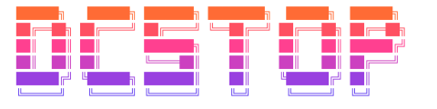

[English](README_en.md) | 日本語

[](https://goreportcard.com/report/github.com/dev-shimada/dcstop)
[](https://github.com/dev-shimada/dcstop/actions/workflows/CI.yaml)
[](https://github.com/dev-shimada/dcstop/blob/main/LICENSE)



# dcstop

DevContainer が作成したコンテナを停止する CLI ツール。

## 概要

VS Code の Dev Containers 拡張機能で作成されたコンテナが「Reopen Locally」しても停止しないことがあります。`dcstop` は対象のコンテナを特定して停止します。

- **image ベース**: `devcontainer.config_file` ラベルでコンテナを特定
- **compose ベース**: `com.docker.compose.project` ラベルでプロジェクトを特定
- **Docker SDK for Go** を使用してネイティブに Docker と連携（shell コマンドを発行しない）

## インストール

### Homebrew
```bash
brew install --casks dev-shimada/dcstop/dcstop
```

### Go install

```bash
go install github.com/dev-shimada/dcstop@latest
```

### リリースからダウンロード

[Releases](https://github.com/dev-shimada/dcstop/releases) から対応するバイナリをダウンロードしてください。

### ソースからビルド

```bash
git clone https://github.com/dev-shimada/dcstop.git
cd dcstop
go build -o dcstop .
```

## 補完
```bash
dcstop completion bash
dcstop completion zsh
dcstop completion fish
```

## 使い方

```bash
# カレントディレクトリの devcontainer を停止
dcstop

# 指定ディレクトリの devcontainer を停止
dcstop /path/to/project

# コンテナを停止後に削除（compose の場合はネットワークも削除）
dcstop --down
dcstop -d /path/to/project

# ボリュームも削除（--down が必要）
dcstop --down --volumes
dcstop -dv /path/to/project

# Docker context を指定して実行
dcstop --context my-remote-docker
dcstop -c desktop-linux /path/to/project

# すべてのプロジェクトを一覧表示してインタラクティブに停止
dcstop global
```

### global サブコマンド

Docker のコンテナラベルを直接参照してすべての devcontainer プロジェクトを一覧表示し、停止するプロジェクトを選択できます。`devcontainer.json` がディスク上になくても動作します。

```
  ██████╗   ██████╗ ███████╗ ████████╗  ██████╗  ██████╗
  ██╔══██╗ ██╔════╝ ██╔════╝ ╚══██╔══╝ ██╔═══██╗ ██╔══██╗
  ██║  ██║ ██║      ███████╗    ██║    ██║   ██║ ██████╔╝
  ██║  ██║ ██║      ╚════██║    ██║    ██║   ██║ ██╔═══╝
  ██████╔╝ ╚██████╗ ███████║    ██║    ╚██████╔╝ ██║
  ╚═════╝   ╚═════╝ ╚══════╝    ╚═╝     ╚═════╝  ╚═╝

  Select devcontainer project to stop

  ▸ ● workspace_devcontainer               image     1 running / 1 total
    ● workspace-node_devcontainer          compose   2 running / 2 total
    ○ workspace-python_devcontainer        image     0 running / 1 total

  /  filter   ↑/↓  move   enter  select   q  quit
```

- `●`（緑）は実行中のコンテナあり、`○`（グレー）は停止中
- `/` キーで名前を入力して絞り込み検索

| キー | 動作 |
|------|------|
| `↑` / `↓` または `Ctrl+P` / `Ctrl+N` | カーソル移動 |
| `/` | 絞り込み検索 |
| `Enter` | 選択して停止 |
| `q` / `Ctrl+C` | キャンセル |

`--down`、`--volumes` フラグも使用できます。

### オプション

| フラグ | 短縮形 | 説明 |
|--------|--------|------|
| `--context` | `-c` | 使用する Docker context を指定 |
| `--down` | `-d` | コンテナを削除（compose の場合はネットワークも削除） |
| `--volumes` | `-v` | ボリュームも削除（`--down` が必要） |
| `--help` | `-h` | ヘルプを表示 |

### Docker Context

`--context` フラグで Docker context を指定できます。指定しない場合は以下の順序で決定されます：

1. `--context` フラグ
2. `DOCKER_CONTEXT` 環境変数
3. `~/.docker/config.json` の `currentContext`（`docker context use` で設定）
4. `DOCKER_HOST` 環境変数
5. デフォルトの Docker ソケット

## 開発

### 必要要件

- Go 1.21+
- Docker

### テスト

```bash
go test ./... -v
```

### ビルド

```bash
go build -o dcstop .
```

## リリース

[GoReleaser](https://goreleaser.com/) を使用してリリースを行います。

### ローカルでのスナップショットビルド

```bash
# GoReleaser のインストール（未インストールの場合）
go install github.com/goreleaser/goreleaser/v2@latest

# スナップショットビルド（リリースせずにビルドのみ）
goreleaser build --snapshot --clean

# または全アーティファクトを生成
goreleaser release --snapshot --clean
```

### リリース

GitHub Actions でタグをプッシュすると自動的にリリースされます。

```bash
# タグを作成してプッシュ
git tag v0.1.0
git push origin v0.1.0
```

手動でリリースする場合:

```bash
# GITHUB_TOKEN を設定
export GITHUB_TOKEN="your_github_token"

# リリース実行
goreleaser release --clean
```

## ライセンス

MIT
